# EXINS Class Diagram

This version omits `StoreContext` and includes attributes and operations on the domain classes. The data fields reflect the project's TypeScript models; methods are UML operations representing the actions available in the application, not methods currently declared on the TypeScript interfaces. `Admin` represents the application's `owner` role. Multiplicities are marked on every relationship; links without stored foreign keys use conceptual cardinalities.

```mermaid
classDiagram
  direction TB

  class UserRole {
    <<enumeration>>
    owner
    staff
    customer
    guest
  }
  class AuthProvider {
    <<enumeration>>
    email
    google
  }
  class BaleStatus {
    <<enumeration>>
    sealed
    opened
    depleted
  }
  class OrderStatus {
    <<enumeration>>
    pending
    preparing
    dropped_to_courier
    completed
    cancelled
  }
  class PaymentMethod {
    <<enumeration>>
    cash
    gcash
    bank_transfer
    card
  }
  class TransactionFlow {
    <<enumeration>>
    inflow
    outflow
  }
  class ItemStatusType {
    <<enumeration>>
    sold
    returned
    damaged
    lost
  }
  class ItemResolutionStatus {
    <<enumeration>>
    lost
    found
    resolved
  }
  class VerificationStatus {
    <<enumeration>>
    pending
    verified
    expired
  }

  class User {
    +uid : String
    +email : String
    +displayName : String
    +role : UserRole
    +isGuest? : Boolean
    +phone? : String
    +address? : String
    +provider? : AuthProvider
    +createdAt? : String
    +login(email: String, password: String) Boolean
    +logout() void
    +updateProfile() void
  }
  class Staff {
    +userId : String
    +manageBale(baleId: String) void
    +processOrder(orderId: String) void
  }
  class Admin {
    +userId : String
    +manageUsers() void
    +manageBales() void
    +manageExpenses() void
    +reviewItemLogs() void
    +manageExbin() void
  }
  class Customer {
    +id : String
    +customerName : String
    +totalPurchase : Number
    +placeOrder(items: OrderItem[]) Order
    +calculateTotalPurchase() Number
  }
  class EmailVerification {
    +email : String
    +status : VerificationStatus
    +sentAt : String
    +verifiedAt? : String
    +sendVerificationEmail() void
    +verifyEmail(token: String) Boolean
    +resendVerificationEmail() void
  }
  class Supplier {
    +id : String
    +name : String
    +contactPerson : String
    +email : String
    +phone : String
    +address : String
    +description : String
    +totalBalesSourced : Number
    +createdAt : String
    +addSupplier() void
    +updateSupplier() void
    +deleteSupplier() void
  }
  class Bale {
    +id : String
    +baleCode : String
    +baleName : String
    +category : String
    +supplierId : String
    +supplierName : String
    +totalPurchasePrice : Number
    +quantityPurchase : Number
    +pricePerPiece : Number
    +description : String
    +status : BaleStatus
    +totalSalesMade : Number
    +createdAt : String
    +addBale() void
    +updateBale() void
    +deleteBale() void
    +calculateRemainingQuantity() Number
  }
  class Product {
    +id : String
    +name : String
    +category : String
    +baleCode : String
    +baleName : String
    +availableQuantity : Number
    +sellingPrice : Number
    +costPrice : Number
    +size : String
    +imageUrl : String
    +productLink : String
    +description : String
    +barcode : String
    +createdAt : String
    +addProduct() void
    +updateProduct() void
    +deleteProduct() void
    +adjustStock(quantity: Number) void
  }
  class Category {
    +id : String
    +name : String
    +description : String
    +color : String
    +totalInStock : Number
    +createdAt : String
    +addCategory() void
    +updateCategory() void
    +deleteCategory() void
    +calculateTotalInStock() Number
  }
  class ExpenseAccount {
    +id : String
    +name : String
    +monthlyBudget : Number
    +description : String
    +totalSpent : Number
    +color? : String
    +createdAt : String
    +addExpenseAccount() void
    +updateExpenseAccount() void
    +deleteExpenseAccount() void
    +calculateRemainingBudget() Number
  }
  class Expense {
    +id : String
    +accountId : String
    +accountName : String
    +amount : Number
    +date : String
    +paymentMethod : PaymentMethod
    +receiptUrl? : String
    +description : String
    +createdAt : String
    +addExpense() void
    +deleteExpense() void
    +calculateTotal() Number
  }
  class Transaction {
    +id : String
    +date : String
    +flowType : TransactionFlow
    +category : String
    +account : String
    +description : String
    +paymentMethod : PaymentMethod
    +inflow : Number
    +outflow : Number
    +orderId? : String
    +expenseId? : String
    +createdAt : String
    +addTransaction() void
    +deleteTransaction() void
    +calculateNetAmount() Number
  }
  class Order {
    +id : String
    +orderNumber : String
    +customerName : String
    +items : OrderItem[]
    +totalAmount : Number
    +status : OrderStatus
    +discount? : Number
    +amountTendered? : Number
    +changeAmount? : Number
    +paymentMethod? : PaymentMethod
    +createdAt : String
    +updatedAt? : String
    +calculateTotal() Number
    +completeSale() void
    +updateStatus(status: OrderStatus) void
  }
  class OrderItem {
    +productId : String
    +name : String
    +category? : String
    +size : String
    +price : Number
    +costPrice? : Number
    +quantity : Number
    +imageUrl? : String
    +baleCode? : String
    +calculateSubtotal() Number
  }
  class ItemLog {
    +id : String
    +productId : String
    +productName : String
    +type : ItemStatusType
    +quantity : Number
    +date : String
    +notes? : String
    +createdAt : String
    +status? : ItemResolutionStatus
    +foundQuantity? : Number
    +foundDate? : String
    +foundNotes? : String
    +logStatus() void
    +updateStatus() void
    +deleteStatusLog() void
  }
  class ExbinTrash {
    +id : String
    +tableName : String
    +recordId : String
    +recordData : Object
    +deletedAt : String
    +expiresAt : String
    +restore() void
    +purgeExpired() void
  }
  class AuditLog {
    +id : Number
    +tableName : String
    +recordId? : String
    +action : String
    +actorId? : String
    +actorName : String
    +actorEmail? : String
    +actorRole : String
    +occurredAt : String
    +recordActivity() void
    +getActivityLogs() AuditLog[]
  }

  Staff "0..1" ..> "1" User : account
  Admin "0..1" ..> "1" User : account
  EmailVerification "0..*" ..> "1" Staff : verifies
  EmailVerification "0..*" ..> "1" Admin : verifies
  Staff "0..*" ..> "0..*" Bale : manages
  Bale "1" ..> "0..*" Product : yields
  Supplier "1" ..> "0..*" Bale : supplies
  Category "1" ..> "0..*" Bale : classifies
  Admin "0..*" ..> "0..*" Bale : manages
  Admin "0..*" ..> "0..*" Expense : manages
  ExpenseAccount "1" ..> "0..*" Expense : records
  Expense "0..1" ..> "0..*" Transaction : creates
  Customer "0..1" ..> "0..*" Order : places
  Staff "0..1" ..> "0..*" Order : processes
  Order "0..1" ..> "0..*" Transaction : creates
  Admin "0..*" ..> "0..*" ItemLog : tracks
  Admin "0..1" ..> "0..*" ExbinTrash : manages
  ExbinTrash "0..1" ..> "0..*" AuditLog : logs
  Order "1" *-- "1..*" OrderItem : contains
```

