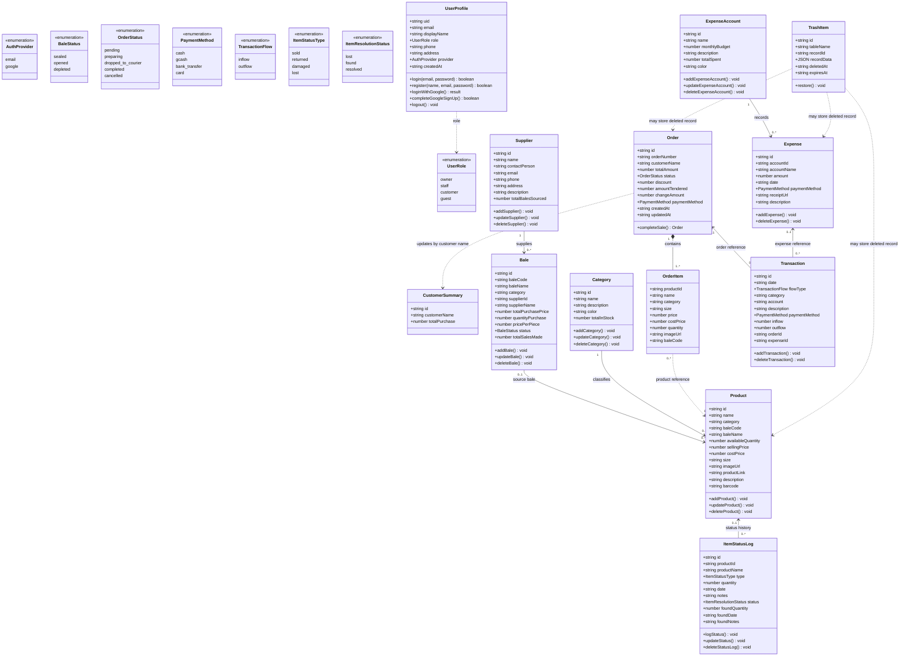

# EXINS Domain Class Diagram

The diagram shows the main business records, their key attributes, and the operations associated with them. Operations are design responsibilities; the TypeScript models themselves are data interfaces.

Dashed relationships indicate application-level references; the database schema does not enforce foreign keys. User roles are values of `UserRole`, not separate user subclasses.
