# EXINS Component Diagram

The application layer represents logical responsibilities, not separate server modules. Most business operations execute in the browser app and use Supabase directly; AI chat and forecast insights are handled by a serverless endpoint.

```mermaid
flowchart TB
  subgraph UI["Frontend (UI Layer)"]
    direction LR
    Storefront["Public Storefront"]
    Dashboard["Owner Dashboard"]
    InventoryUI["Inventory Management"]
    POSUI["Point of Sale and Receipts"]
    FinanceUI["Finance Management"]
    ForecastUI["Sales Forecasting"]
    ChatbotUI["AI Chatbot"]
    AdminUI["Status Tracking and Recycle Bin"]
    Navigation["Navigation"]
    LoginUI["Login and Registration"]
  end

  subgraph APP["Backend (Application Layer)"]
    direction LR
    AppLogic["Shared Application State and Role-Based Access"]
    Catalog["Product Catalog and Browsing"]
    InventoryOps["Inventory and Supplier Operations"]
    SalesOps["Sales and Order Processing"]
    FinanceOps["Expense and Transaction Processing"]
    AdminOps["Status Tracking and Record Recovery"]
    Analytics["Dashboard Analytics and Forecast Preparation"]
    AIHandler["AI Insight Request Handler<br/>(Serverless)"]
  end

  subgraph API["API Integration Layer"]
    direction LR
    AuthConnector["Authentication Connector<br/>(Supabase Auth)"]
    DataConnector["Database Connector<br/>(Supabase REST / PostgREST)"]
    RealtimeConnector["Live Data Connector<br/>(Supabase Realtime)"]
    AIConnector["AI Provider Connector<br/>(OpenRouter API)"]
    AIModel["NVIDIA Nemotron 3 Ultra<br/>(model selected through OpenRouter)"]
  end

  subgraph DATA["Database (Data Layer)"]
    direction LR
    UserData[("User Accounts and Profiles")]
    InventoryData[("Inventory Records<br/>Products, Categories, Bales, Suppliers")]
    SalesData[("Sales Records<br/>Orders, Order Items, Customer Summaries")]
    FinanceData[("Financial Records<br/>Expense Accounts, Expenses, Transactions")]
    AdminData[("Status Logs and Recycle Bin")]
  end

  Storefront --> AppLogic
  Dashboard --> AppLogic
  InventoryUI --> AppLogic
  POSUI --> AppLogic
  FinanceUI --> AppLogic
  ForecastUI --> AppLogic
  ChatbotUI --> AppLogic
  AdminUI --> AppLogic
  Navigation --> AppLogic
  LoginUI --> AppLogic

  AppLogic --> Catalog
  AppLogic --> InventoryOps
  AppLogic --> SalesOps
  AppLogic --> FinanceOps
  AppLogic --> AdminOps
  AppLogic --> Analytics
  ChatbotUI --> AIHandler
  ForecastUI --> AIHandler

  AppLogic --> AuthConnector
  Catalog --> DataConnector
  InventoryOps --> DataConnector
  SalesOps --> DataConnector
  FinanceOps --> DataConnector
  AdminOps --> DataConnector
  Analytics --> DataConnector
  Analytics --> RealtimeConnector
  AIHandler --> AIConnector
  AIConnector --> AIModel

  AuthConnector --> UserData
  DataConnector --> UserData
  DataConnector --> InventoryData
  DataConnector --> SalesData
  DataConnector --> FinanceData
  DataConnector --> AdminData
  RealtimeConnector --> InventoryData
  RealtimeConnector --> SalesData
  RealtimeConnector --> FinanceData

  classDef ui fill:#eaf2ff,stroke:#3766a3,color:#172b4d
  classDef app fill:#edf8ee,stroke:#43834a,color:#1f3a24
  classDef api fill:#fff5df,stroke:#aa7a12,color:#4d3908
  classDef data fill:#f4edff,stroke:#7651a3,color:#2d1f42

  class Storefront,Dashboard,InventoryUI,POSUI,FinanceUI,ForecastUI,ChatbotUI,AdminUI,Navigation,LoginUI ui
  class AppLogic,Catalog,InventoryOps,SalesOps,FinanceOps,AdminOps,Analytics,AIHandler app
  class AuthConnector,DataConnector,RealtimeConnector,AIConnector,AIModel api
  class UserData,InventoryData,SalesData,FinanceData,AdminData data
```

