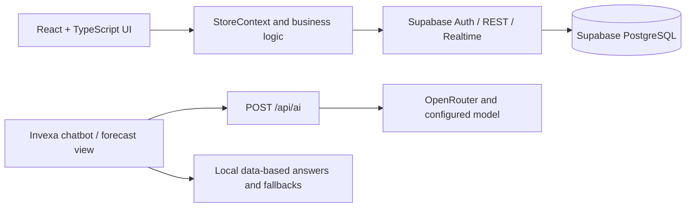

# EXINS System Technology Brief

## System overview

EXINS is a web-based inventory and store-operations system for Jksur+ Novaliches. It brings product and bale inventory, point of sale (POS), receipts, expenses, transactions, sales forecasting, and a public product showcase into one application. Owner and staff experiences are role-aware; the owner has access to administrative and financial areas, while staff workflows focus on sales and inventory.

## Technology stack

| Area | Technology | Role in the system |
|---|---|---|
| User interface | React 19 and TypeScript | Builds the interactive, component-based application and its typed business data. |
| Development and build | Vite 8 | Runs the local development server and bundles the browser application for deployment. |
| Styling | Tailwind CSS 4 | Provides utility-based styling for responsive views and application themes. |
| Icons | Lucide React | Supplies the interface icon set. |
| Authentication and database | Supabase Auth and Supabase PostgreSQL | Provides user authentication and the persistent application data store. |
| Browser data access | Supabase JavaScript client | Reads and writes database records through Supabase REST/PostgREST and subscribes to Realtime database changes. |
| AI services | OpenRouter SDK | Sends scoped chatbot and forecast-insight requests to the configured language model. |
| Hosting and server API | Vercel serverless functions | Hosts the `/api/ai` endpoint and keeps the OpenRouter API key on the server. |
| Local development | Node.js and npm | Installs project dependencies and runs the scripts defined in `package.json`. |

The default OpenRouter model is configured as `nvidia/nemotron-3-ultra-550b-a55b:free`; deployments can override it with `OPENROUTER_MODEL`.

## Application architecture

The frontend is a single-page React application. `App` selects views according to the current user role, while `StoreContext` maintains shared application state and coordinates business operations. The Supabase client in `src/lib/supabase.ts` adapts database access and realtime subscriptions for the rest of the application.



Core application areas include:

- **Storefront and catalog:** public product browsing and category filtering.
- **Inventory:** products, categories, bales, suppliers, and item-status records.
- **POS and receipts:** sales orders, payment details, receipts, and stock updates.
- **Finance:** expense accounts, expenses, and inflow/outflow transactions.
- **Dashboard and sales forecasting:** operational summaries and projections based on recorded sales.
- **Invexa:** business-data questions and forecast explanations, with a local data-based fallback when the AI provider is unavailable.
- **Administration:** status logs and the exBIN record recovery workflow.

## Data and AI flow

Operational data is stored in Supabase PostgreSQL. The browser application accesses Supabase using a publishable/anon key and receives updates through Supabase Realtime subscriptions. Selected application data is also cached in browser `localStorage`; this cache supports application continuity but should not be treated as the authoritative database.

For AI features, the browser sends a question or forecast summary and its prepared business context to `/api/ai`. The serverless function calls OpenRouter using the server-side `OPENROUTER_API_KEY`. Invexa's context is designed to provide business metrics without sending customer names or supplier contact details. If the key is missing or the provider is unavailable, the application can return a labeled local, data-based answer instead. Forecast outputs are projections and are not guarantees.

## Security and operational considerations

- Configure Supabase Row Level Security (RLS) policies for the application tables. Hiding a screen in the frontend is not a substitute for database authorization.
- Keep the Supabase publishable/anon key in the browser configuration only; never expose a Supabase `service_role` or secret key in a `VITE_` or `NEXT_PUBLIC_` variable.
- Store `OPENROUTER_API_KEY` as a server-side environment variable. Do not commit real API keys or secrets.
- Because business data is cached in `localStorage`, use care on shared devices and clear browser storage when appropriate.
- The application depends on correct Supabase table definitions, access policies, and enabled Realtime publication for live updates.

## Configuration and developer commands

Required deployment configuration:

- `VITE_SUPABASE_URL` and `VITE_SUPABASE_PUBLISHABLE_KEY` for the browser application.
- `OPENROUTER_API_KEY` for server-backed AI responses.
- `OPENROUTER_MODEL` is optional and overrides the default model.

Useful project commands:

```sh
npm install
npm run dev
npm run lint
npm run build
```

In this project, `npm run lint` runs the TypeScript compiler in no-emit mode (`tsc --noEmit`).

## Related documentation

- [Project setup and deployment notes](../README.md)
- [Component and architecture diagram](./component-diagram.md)
- [Application class diagram](./application-class-diagram.md)
- [Sequence diagrams](./sequence-diagrams/)
